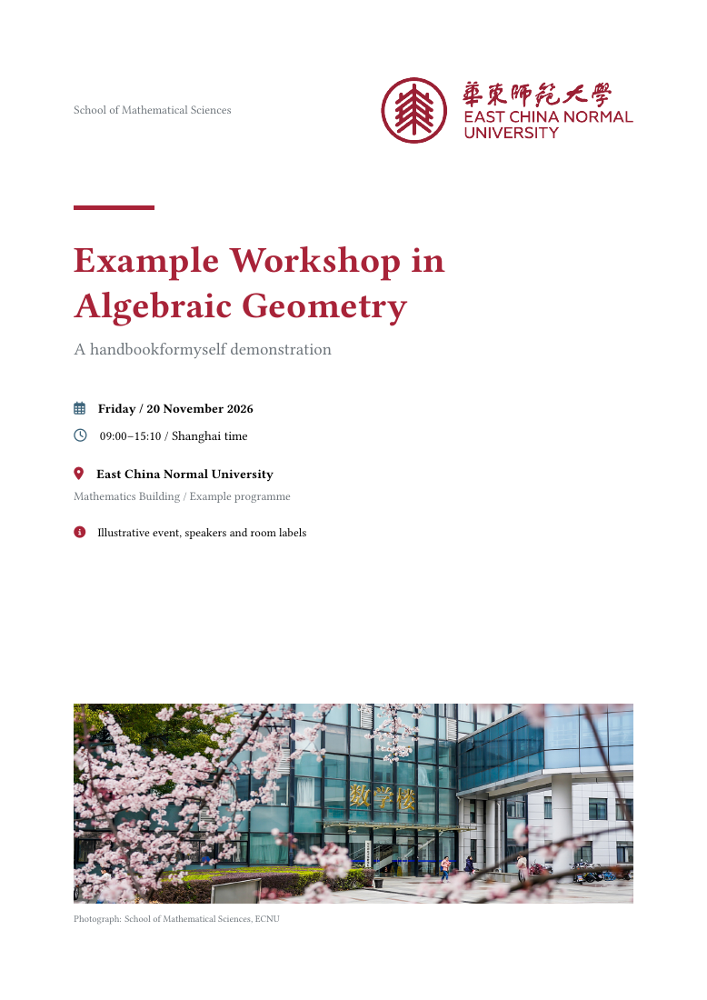

# handbookformyself

A small, readable XeLaTeX template for conference handbooks. One style file,
one explicit content file, white pages and functional colours.

一个便于人工阅读和修改的会议手册模板。样式集中在 `handbookformyself.sty`，报告、封面、日程与分页直接写在 `main.tex`。

<a href="main.pdf"></a>

## 预览与文件

- [电子版示例](main.pdf)
- [双面打印版示例](main-print.pdf)
- [完整示例源码](main.tex)
- [样式文件](handbookformyself.sty)

```text
handbookformyself/
├── handbookformyself.sty
├── main.tex
├── main.pdf
├── main-print.pdf
├── preview.png
├── README.md
├── LICENSE
├── .gitignore
└── assets/
    ├── ecnu-logo.png
    ├── ecnu-math-building.jpg
    └── SOURCES.md
```

示例使用 ECNU 标识和数学楼照片；活动、讲者与房间信息是演示内容。示范摘要为原创说明性文字，没有收录实际会议的投稿。素材说明见 [assets/SOURCES.md](assets/SOURCES.md)。

## 编译

推荐使用较新的完整 TeX Live；本示例使用 TeX Live 2026 与 XeLaTeX 验证。编译需要 `latexmk`、`fontawesome6`、`ctex`、`fontspec`、`unicode-math`、TikZ、`tcolorbox`、`fancyhdr`、`hyperref` 等宏包，以及 Libertinus、Fandol 字体。STIX Two Math 可选：未安装时保留 Libertinus 的数学字母。

在本目录运行：

```console
latexmk -xelatex -interaction=nonstopmode -halt-on-error -outdir=output/pdf main.tex
```

结果位于 `output/pdf/main.pdf`。根目录的两份 PDF 是随仓库提供的预览，辅助编译文件由 `.gitignore` 忽略。编译不需要联网，也不需要从上级目录读取文件。

### 电子版与打印版

在 `main.tex` 开头选择：

```tex
\printmodefalse % 默认电子版：封面后直接进入正文。
% \printmodetrue % 双面打印：封面背面留白，正文第 1 页落在右页。
```

开启打印模式后，可用不同文件名保留打印版：

```console
latexmk -xelatex -interaction=nonstopmode -halt-on-error -outdir=output/pdf -jobname=main-print main.tex
```

两种模式都不把封面计入正文页码；外侧页脚为“当前页 / 正文总页数”，内侧页脚为空。栏目和会议短名在左右页镜像放置。开关只控制封面背面的空白页，其他分页由内容文件中的 `\clearpage` 决定。

## 从哪里开始修改

新会议把样式文件和内容文件放在同一目录，按下面的方式加载：

```tex
\documentclass[a4paper,11pt,twoside]{article}
\usepackage{handbookformyself}
```

1. 设置 `\printmodefalse` 或 `\printmodetrue`。
2. 调整开头的功能色、`\RunningTitle` 和 PDF 元数据。
3. 替换 `\DeclareTalk` 中的讲者、单位、题目与摘要。
4. 直接修改 `titlepage` 内的封面文字、图片与间距。
5. 在日程和摘要部分分别列出报告 ID，并填写日程时间。
6. 修改会议须知、后勤示意图和其他栏目。

`main.tex` 覆盖了五个报告、较长题目、缺省单位、数学题目、多段摘要、陈列公式、列表、中文文字、目录、会议须知、全部五种 box、后勤示意图和自由栏目。它是一份完整示例，可以直接删减。

## 报告只登记一次

在导言区声明：

```tex
\DeclareTalk{sample-talk}{
  speaker={Sample Speaker},
  affiliation={Example University},
  title={Geometry over $\mathbb C$}
}{
  The abstract may contain ordinary LaTeX and $H^1(X,\mathcal O_X)$.

  A second paragraph, an equation or a list is allowed.
}
```

`speaker`、`title` 必填，`affiliation` 可省略。ID 建议使用英文字母、数字与短横线。题目中含逗号时保持外层花括号；摘要中可直接使用公式与多段正文。

正文明确安排出现位置：

```tex
\HandbookSection[HBTime]{Schedule}[Friday / 20 November 2026]
\HandbookSubsection[\faIcon{users}]{Morning}[09:00--11:30 / Room A]
\ScheduleItem{09:00--09:40}{sample-talk}
\ScheduleBreak[coffee]{09:40--10:00}{Coffee}

\clearpage
\HandbookSection[HBTalk]{Abstracts}
\TalkAbstract{sample-talk}
```

时间属于 `\ScheduleItem`，不属于报告记录，摘要页不显示时间。报告编号按声明顺序固定；调整日程顺序时直接调整 ID 列表。模板不自动排序、检查时间冲突或将报告加入正文。

日程中的题目和姓名会链接到对应摘要；若没有使用该报告的 `\TalkAbstract`，则按普通文字显示。

## 分段与页眉

| 命令 | 用途 |
| --- | --- |
| `\RunningTitle{短会议名}` | 设置内侧页眉；外侧显示当前栏目 |
| `\HandbookSection[颜色]{标题}[副标题]` | 25pt 大分段，无编号，自动加入目录，不强制分页 |
| `\HandbookSubsection[图标命令]{标题}[说明]` | 16pt 小分段，图标与说明可省略 |

大、小标题都没有预设内容类别。会议须知、日程、摘要、食宿交通或自定义栏目直接在内容文件中命名。小分段有说明时，在说明下方绘制 `HBMain!35`、粗 `0.4pt` 的横线；实现就在 `\HandbookSubsection` 中。

```tex
\HandbookSection{Meeting information}
\HandbookSubsection{Organisers}
\HandbookSubsection[\faIcon{map}]{Maps}
\HandbookSubsection[\faIcon[regular]{clock}]{Opening times}[09:00--17:00]
\HandbookSection[HBBreak]{Logistics}
\HandbookSection[HBMuted]{Any additional section}
```

## 日程与摘要

| 命令 | 用途 |
| --- | --- |
| `\ScheduleItem{时间}{报告ID}` | 12pt 报告行，时间、讲者与题目分栏，题目栏较宽 |
| `\ScheduleBreak[图标名]{时间}{说明}` | 统一休息色，时间后接浅虚线，说明相对整行居中 |
| `\TalkAbstract{报告ID}` | 输出完整题目、讲者、单位和摘要 |

休息图标默认是 `interval`，也可用 `coffee`、`meal`、`discussion`。长说明会自动居中换行，虚线填满两侧余白。

在示例的 11pt 文档中，摘要正文与讲者为 12pt、单位为 11pt、题目为 15pt，局部使用 `\linespread{1.2}`。每段首行缩进 `2em`，讲者姓名前有 FA 人物图标。标题与正文开头保持在一起，长摘要可以自然跨页，段首和段尾避免单独一行跨页。

## 五种 box

所有 box 都是白底，可自然跨页，接受可选的显示标题：

```tex
\begin{noticebox}[Notes for speakers]
  Presentation arrangements go here.
\end{noticebox}
```

| 环境 | 默认标题 | 用途 |
| --- | --- | --- |
| `sessionbox` | Session | 场次说明 |
| `talkbox` | Talk | 报告或讨论说明 |
| `breakbox` | Break | 休息、用餐与交流 |
| `noticebox` | Notice | 提醒，带细左侧线 |
| `infobox` | Information | 常规信息，带细左侧线 |

## 配色、字体与图标

功能色可在加载模板后用标准 `xcolor` 命令覆盖：

```tex
\definecolor{HBMain}{HTML}{A82338}
\colorlet{HBBreak}{green!45!black}
```

| 颜色名 | 用途 |
| --- | --- |
| `HBMain` | 主要栏目、场次、人物与地点图标 |
| `HBTime` | 时间与日程 |
| `HBTalk` | 报告与摘要 |
| `HBBreak` | 休息、讨论与浅虚线 |
| `HBNotice` | 提醒 |
| `HBMuted` | 单位与次要信息 |

示例主色 `#A82338` 由所提供 ECNU 标识的原色 `#9B2034` 调亮而来。它是示例的主题配色，不是学校 VI 标准色声明。

正文、标题和页眉使用 Libertinus Serif；数学使用 Libertinus Math，中文使用 Fandol 宋体，中文等宽回退使用 Fandol 仿宋。字体设置集中在样式文件的第一部分。

图标使用 [fontawesome6](https://ctan.org/pkg/fontawesome6)。可以直接调用 `\faIcon{map}`，或者使用带功能色的别名：

```tex
\HandbookIcon{clock}
\HandbookIcon{speaker}
```

别名有 `clock`、`day`、`location`、`session`、`speaker`、`talk`、`break`、`interval`、`coffee`、`discussion`、`meal`、`notice`、`info`。TikZ 同时用于 box 和报告字段处理，示例的后勤示意图也直接使用 TikZ。

## 维护方式

样式按字体、颜色、图标、报告登记、页面布局、分段命令、box 与内容排版的顺序组织。两个源文件都用十个空行分隔主要功能区。

改样式时编辑 `.sty`；改会议内容、封面和分页时编辑 `main.tex`。新增一天或平行场次时，继续添加小分段并明确列出报告 ID 即可，不必建立新的数据层。

## 编译提示

当前部分 FA6 图标组合会让 XeLaTeX 的 `xdvipdfmx` 报出 `ToUnicode CMap` 警告。图标已嵌入且显示正常，但图标本身的文本提取没有可靠的 Unicode 映射。这里使用宏包公开接口，未加入字体内部补丁。

## 验证

示例电子版八页（封面一页、正文七页），打印版九页（增加一页封面背面留白）。两种模式已编译并逐页核对，日程与摘要链接、目录、页码和示意图正常，最终日志没有溢出、缺字或字体警告。

另将此目录的源文件和素材复制到隔离位置从零编译，确认没有读取上级目录的模板或会议内容。公开示例没有实际会议投稿数据。

## 来源与许可

模板代码、示例正文、示意图和本项目文档采用 [MIT License](LICENSE)。ECNU 标识及照片属于第三方素材，其来源与权利单独列于 [assets/SOURCES.md](assets/SOURCES.md)，不包含在模板软件的 MIT 授权范围中。

版式参考 [AMCOS_booklet](https://github.com/maximelucas/AMCOS_booklet/) 的日程组织与摘要层次。本模板独立实现，没有复制该项目的类文件或脚本。
